# Vestigian — Project Summary

_An atlas of the ancient world, recorded by the people who visit it._

This document is a technical deep-dive for interested, technically literate
readers. It covers accessibility, security, architecture, the technology
stack, the request lifecycle, the full feature set, how borrowed data is
cross-checked and enriched, and the legal/GDPR posture. It reflects the
codebase and its documented design decisions as of **2026-09-07**.

---

## Table of contents

1. [What Vestigian is](#1-what-vestigian-is)
2. [Architecture](#2-architecture)
3. [Technology stack](#3-technology-stack)
4. [Request flow](#4-request-flow)
5. [Feature list](#5-feature-list)
6. [Cross-information, verification & enrichment](#6-cross-information-verification--enrichment)
7. [Accessibility (a11y)](#7-accessibility-a11y)
8. [Security](#8-security)
9. [GDPR & legal](#9-gdpr--legal)
10. [Observability](#10-observability)
11. [Other notable engineering decisions](#11-other-notable-engineering-decisions)

---

## 1. What Vestigian is

Vestigian ("traces") is an atlas of the ancient world — settlements, roads,
fortifications, findspots — built on openly-licensed data originally
compiled by [vici.org](https://vici.org), reimplemented independently with
its own visual language, stack, and governance model. It is **not** a fork:
the data is shared, the code and character are not.

**Design brief:** "a field notebook carried through Roman Europe." Aged
laid-paper backgrounds, iron-gall-ink text, one oxide-red accent used once
per screen, bronze linear features, verdigris reserved for
approved/confirmed states, self-hosted Fraunces/IBM Plex type — every visual
decision traces back to that one sentence.

**Status:** the map runs on real, imported data — 61,272 sites, 11,720
tracings, rendered live through PostGIS `ST_AsMVT`. Everything above the map
(auth, contribution, moderation, revisions) has since been built out and
exercised, including a full opt-in two-factor authentication system.

---

## 2. Architecture

### 2.1 High-level system diagram

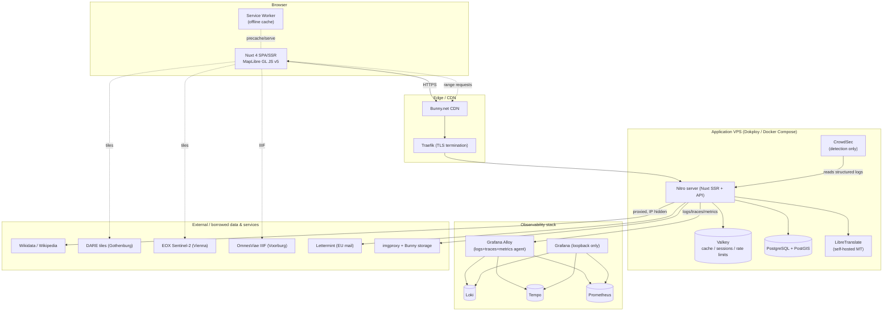

### 2.2 Why these choices

| Layer                          | Choice                                          | Why (vs. the alternative)                                                                                                                                                                  |
| ------------------------------ | ----------------------------------------------- | ------------------------------------------------------------------------------------------------------------------------------------------------------------------------------------------ |
| Map rendering                  | **MapLibre GL JS v5**                           | Vector + GPU; clusters 20k+ sites and styles 1k+ tracings without DOM thrashing (Leaflet) and with better mobile feel than OpenLayers; no per-load fee (Mapbox GL).                        |
| Spatial queries                | **PostGIS `ST_AsMVT`**                          | Answers the viewport with _tiles_, not bbox GeoJSON — the single most important architectural decision in the project.                                                                     |
| Basemap delivery               | **PMTiles** (OpenFreeMap in dev)                | Custom style keeps the app's own character; read directly by the browser over HTTP range requests — **no tile server process**.                                                            |
| ORM                            | **Drizzle + `postgres.js`**                     | TypeScript-first, compile-time-checked columns; raw SQL kept to exactly the PostGIS operations a query builder cannot express.                                                             |
| Cache/session/rate-limit store | **Valkey**                                      | Redis-compatible, no licensing ambiguity.                                                                                                                                                  |
| Media                          | **Bunny.net + imgproxy**                        | One stored original per image; derivatives generated on the fly; zero egress cost.                                                                                                         |
| Mail                           | **Lettermint** (EU)                             | Transactional mail entirely inside the EU — replaced a US-hosted provider once the rest of the stack (CDN, object store) had already moved.                                                |
| Drawing tool                   | **terra-draw**                                  | Framework-agnostic vector drawing that plugs directly into MapLibre.                                                                                                                       |
| Telemetry                      | **Grafana + Loki + Tempo + Prometheus + Alloy** | One agent (Alloy) carries logs, traces _and_ metrics — Vector carries no traces, and Alloy's built-in exporters replace four separate exporter containers. Everything lands on local disk. |
| Deployment                     | **Dokploy on one Hetzner VPS**                  | ~€27/month all-in vs ~€60–90 for managed Kubernetes; Dokploy _is_ Compose, so dev and prod share one artifact.                                                                             |

The application is strictly **12-factor** (env-only config, no local-disk
writes, `/api/health` + `/api/ready`), so a future move to Kubernetes is a
translation exercise, not a rewrite.

### 2.3 Governance & data-write architecture

Every mutation to a shared record (a site or a tracing) is designed around
one non-negotiable rule:

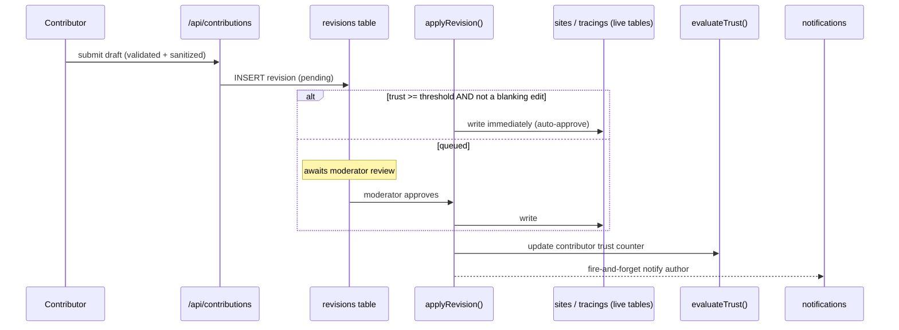

Key invariants (enforced in code, documented in `CLAUDE.md`, and treated as
load-bearing — never to be "quietly" weakened):

- **`applyRevision()` is the only function that ever writes a live row.**
  Automatic approval, moderator approval, and revert all funnel through it.
- **History is append-only.** A revert writes a _new_ revision restoring the
  prior state; nothing is ever deleted.
- **Trust model:** new accounts are queued; after 2 accepted contributions,
  edits publish immediately (`evaluateTrust`). Moderators can revoke trust.
  A moderator can never approve their own contribution.
- **An edit that removes more than it adds is always queued**, regardless of
  the author's trust level (`isBlankingEdit`).
- **Nobody can change their own role, and no admin can demote another
  admin** — removing an admin requires direct database access, the same as
  creating the very first one.
- **Role/trust are re-read from the database on every guarded request** —
  never trusted from the session cookie, so a demotion takes effect on the
  very next request rather than at next login.
- **Slugs never change on edit** — inbound links, citations, and the sitemap
  all depend on permanence.

### 2.4 Versioning & releases

Semantic versioning via [Changesets](https://github.com/changesets/changesets)
— deliberately not Conventional-Commits-driven tooling (`semantic-release`,
`standard-version`), because this repo's `commit-msg` hook protects a
freeform, lowercase, imperative commit style with no type prefix, structural
rather than convention-based. A changeset is a small file under
`.changeset/`, independent of the commit message, recording what changed and
how it should move the version.

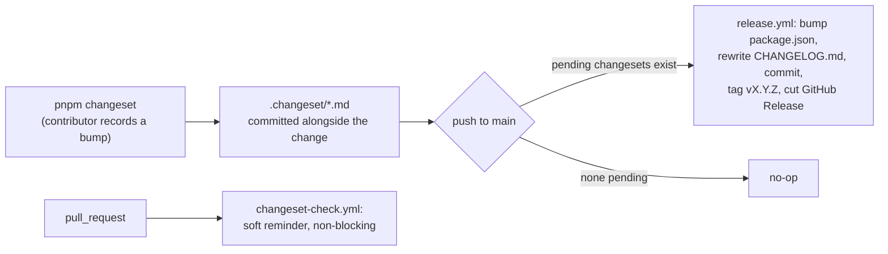

**The primary path is a direct push to `main`** — this project has no
release-PR step to merge, commits land on `main` directly, so the release
workflow runs the bump/tag/release in the same push rather than opening a
"Version Packages" PR the way Changesets' own GitHub Action normally would.
A `[skip release]` marker on the bump commit stops it from re-triggering
itself. **The secondary path is a branch/PR** — a non-blocking check that a
branch touching app code carries a changeset. Deploy images additionally
carry a `v${version}` tag alongside `latest` and the commit SHA, so a
specific release can be pulled or rolled back to by name rather than only by
SHA.

---

## 3. Technology stack

```mermaid
mindmap
  root((Vestigian stack))
    Frontend
      Nuxt 4 / Vue 3
      Nuxt UI v3 (Reka UI)
      MapLibre GL JS v5
      terra-draw
      Tailwind v4 (design tokens)
      @vite-pwa/nuxt (Service Worker)
      OpenSeadragon (IIIF deep zoom)
      @fontsource (self-hosted fonts)
    Backend
      Nitro (Nuxt server engine)
      Drizzle ORM
      postgres.js (raw PostGIS)
      argon2id
      otpauth + qrcode (TOTP 2FA)
      ALTCHA (self-hosted proof-of-work captcha)
      sharp (image re-encode)
      ODC / iron-seal sessions (nuxt-auth-utils)
    Data
      PostgreSQL + PostGIS
      Valkey
      MinIO/Bunny object storage
    External data sources
      vici.org import (MySQL dump)
      AWMC (Barrington Atlas + minor antiquities, ODbL)
      Pleiades (CC BY)
      DARE raster tiles (CC BY-SA/NC mix)
      EOX Sentinel-2 (CC BY-NC-SA)
      GeoNames cities500 (CC BY)
      EDH findspots (CC BY-SA)
      Natural Earth country boundaries (public domain)
      OmnesViae / Tabula Peutingeriana (unlicensed, gated)
      Wikidata battles (CC0)
      Catalogue of Ancient Ports (CC BY)
      ORBIS v2 routes (CC BY)
      CHRR coin hoards (CC BY-NC-SA)
      OpenHistoricalMap empire extents (CC0)
      Wikimedia Commons Cichorius Plates, mirrored (public domain)
      Heidelberg UL IIIF, Column of Marcus Aurelius, live proxy (public domain)
    Observability
      Grafana Alloy
      Loki / Tempo / Prometheus / Alertmanager
    Security
      CrowdSec (detection)
      ALTCHA
      argon2id
    i18n
      "@nuxtjs/i18n (6 locales)"
      LibreTranslate (self-hosted MT)
    Deployment
      Docker Compose
      Dokploy
      Traefik
      GitHub Actions -> GHCR
```

### 3.1 Client-side query split

| Client                             | Used for                | Why                                                                                                                                      |
| ---------------------------------- | ----------------------- | ---------------------------------------------------------------------------------------------------------------------------------------- |
| **Drizzle (`useDatabase()`)**      | Default for all queries | Compile-time-checked columns and typed rows.                                                                                             |
| **Raw `postgres.js` (`useSql()`)** | PostGIS-only — 8 files  | `ST_AsMVT`, `ST_AsMVTGeom`, `ST_SetSRID`/`ST_MakePoint`/`ST_GeomFromGeoJSON`, geography casts, `ST_AsGeoJSON`, the readiness `SELECT 1`. |

The two hold **separate connections**, so a transaction can never span both
— which is exactly why `applyRevision()` (geometry write + trust counter,
one atomic unit) picks a single client for the whole operation.

---

## 4. Request flow

### 4.1 A map tile request (the hot path)

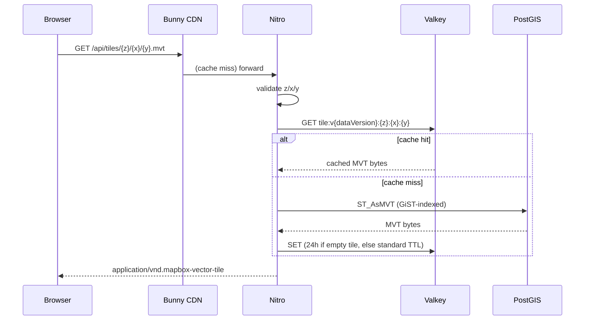

Design rules that keep this fast:

- **Below zoom 9:** counted clusters, snapped to a grid in _projected_
  space. **At zoom 9+:** individual sites. **Tracings from zoom 7**,
  simplified with a tolerance derived from metres-per-pixel.
- **Tiles carry only `id`, `slug`, `title`, `category`.** Descriptions and
  images are fetched on demand via `/api/sites/:id` — keeping tiles small
  and cacheable far longer than editable content would otherwise allow.
- **Cache invalidation is one counter** (`bumpDataVersion()`), so an
  approval invalidates every cached tile at once without a scan/delete.
- **Empty tiles are cached for 24h** — most of the world's surface is ocean.

### 4.2 A contribution's full lifecycle

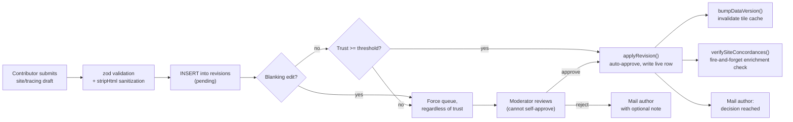

### 4.3 Login with optional two-factor

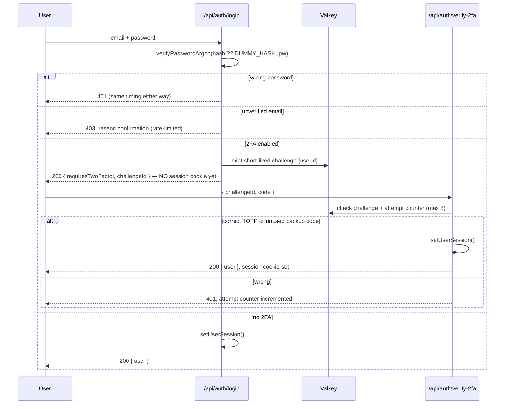

---

## 5. Feature list

### 5.1 Map & exploration

- **MapLibre-powered vector map** with clustered sites, tracings, category
  markers, and a legend that adapts to the active basemap.
- **Six basemap views**, in two switcher groups:
  - _Modern:_ **Vestigian** (recolored vector basemap) and **Satellite**
    (Sentinel-2 cloudless raster).
  - _Antiquity:_ **DARE** (Åhlfeldt's raster sheet) and **Barrington**
    (self-built from AWMC + Pleiades vector data, including a "Follow the
    limes" frontier overlay).
- **Tabula Peutingeriana** — a standalone IIIF deep-zoom viewer of the
  actual manuscript (OpenSeadragon), plus a separate, off-by-default
  **network overlay** showing the roads and towns it records at their real
  coordinates (gated behind an operator flag — its source states no
  licence, so nothing is served until that's confirmed with the maintainer).
- **A dedicated overlay switcher**, separate from the basemap menu, holding
  every switchable layer over the map: contributed sites, the limes
  frontier, the Tabula Peutingeriana network, Wikidata battles, the
  Catalogue of Ancient Ports, ORBIS Roman routes, AWMC's minor antiquities
  (bridges, mines, quarries and more), and CHRR coin hoards — each off by
  default, each crediting its own source in the map's own attribution the
  moment it's switched on.
- **Column reliefs** (`/columns`) — Trajan's Column, mirrored from Wikimedia
  Commons' Cichorius Plates into this project's own storage, and the Column
  of Marcus Aurelius, served live via a server-side IIIF proxy onto
  Heidelberg University Library's own digitisation (a direct browser fetch
  to that host fails outright; only a server-side request succeeds). Both
  use an OpenSeadragon deep-zoom viewer — real pan/zoom-to-pointer, not a
  scrolling image frame — with a shared, typeable page pager; the Marcus
  Aurelius viewer additionally remembers the volume and plate a reader left
  off at.
- **Full-text-lite site search** across contributed titles/summaries _and_
  235k+ modern city/town names (self-hosted GeoNames table, ranked so exact
  prefix matches beat fuzzy trigram noise).
- **Offline maps:** a bounded, explicit "download this area" flow (three
  detail tiers), backed by a Service Worker precache and a measured, sampled
  size estimate before download — never a blanket "cache everything."
- **Geolocation button**, mobile-first responsive layout.

### 5.2 Contribution & editing

- Site and tracing **draft editors** (Nuxt UI form controls, no hand-rolled
  inputs), a geometry draw tool (terra-draw), and an image uploader.
- **Every submission goes through the revision pipeline** described in §2.3
  — nothing bypasses moderation review when trust or blanking rules say it
  shouldn't.
- **Revision history and diffing** (`RevisionDiff.vue`) visible per record.

### 5.3 Moderation

- **Review queue** with per-revision notes, batch actions, and a
  contributor table (trust level, suspension with a required reason field).
- **Suspension leaves prior approved contributions untouched** — restoring
  trust returns someone exactly where they left off.

### 5.4 Accounts & identity

- Registration with **ALTCHA proof-of-work** + honeypot + per-IP rate limit
  - email verification.
- **Opt-in TOTP two-factor authentication** — QR enrollment, 10 single-use
  backup codes (shown once, copy-or-download), disable requires _both_
  password and a code.
- Password reset, email change (parked on a token until the new address is
  proven reachable), account export (GDPR data portability), account
  deletion (anonymization, not hard delete).
- **Public contributor profile pages**, opt-in, a strict projection (no
  email, no role, no trust state, no location data).

### 5.5 The field notebook (this project's one feature vici.org has no analogue for)

- **"I have stood here"** — private visit records (`site_visits`), never
  joined to any public feed, never entering the tile pipeline.
- **"Places to go"** — private bookmarks (`site_bookmarks`).
- **GPX field kit export** (`/api/me/field-kit.gpx`) — a hand-written,
  fully-escaped GPX 1.1 file of a user's notebook places, usable on any
  handheld GPS or offline map app.
- **Milestones** — eight named achievements, derived on read and stored
  nowhere (no points, streaks, or leaderboards by design — a leaderboard
  would reward speed over substance).
- **"Found this useful" endorsements** — a public per-site count from a
  strictly private table (no identity of the endorser ever surfaces, on any
  surface, to anyone including moderators).

### 5.6 Enrichment & cross-referencing

See §6 for the full mechanism. In short: live Wikipedia extracts in six
languages, verified concordances against Wikidata/EDH/iDAI.gazetteer/Historic
England, and machine translation on demand — nothing is ever republished as
stored content.

### 5.7 Internationalization

Six interface languages (EN, FR, ES, DE, IT, NL) via `@nuxtjs/i18n` with a
cookie-based locale (not URL-prefixed), bootstrapped from a single English
source catalogue through a self-hosted LibreTranslate instance.

### 5.8 SEO & discoverability

- Hand-rolled, paginated **sitemap index** (sites, tracings, static pages,
  limes sectors — each under the 50,000-URL/50 MB sitemaps.org cap).
- `robots.txt` + page-level `noindex` (two distinct mechanisms, used
  together deliberately).
- JSON-LD structured data (`schema.org/Place`) for sites and tracings.
- Open Graph images: real photo when available, one of eleven static
  category cards otherwise.
- A public, machine-readable **OpenAPI document** (dev-only — 404s in
  production), built by merging Nitro's auto-generated shape with each
  route's real zod validation schema, so documentation can never silently
  drift from what a handler actually enforces. Interactive UI at
  `http://localhost:3000/_scalar` while `pnpm dev` is running; raw document
  at `/api/openapi.json`.

---

## 6. Cross-information, verification & enrichment

Vestigian treats every borrowed identifier as **a lead, not a guarantee** —
this is one of its more carefully engineered subsystems.

### 6.1 The core problem, measured

Sampling 30 sites that already carried a Wikidata id from the vici.org
import: coordinate agreement had a **median of 53 m**, but a **p90 of
1,050 m**, and a worst case of **35.8 km** — a Q-id that pointed at a modern
municipality rather than the actual ruin. Roughly a tenth of "verified"
identifiers were simply wrong.

### 6.2 The verification gate

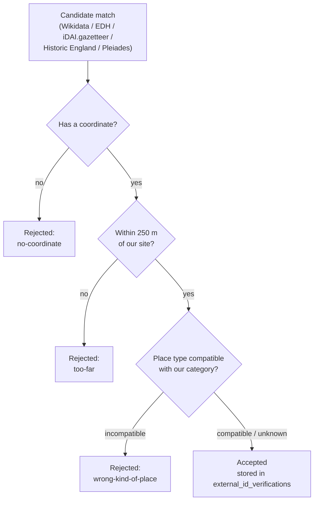

- **250 m** was chosen empirically: 19 of 29 comparable samples fell inside
  it; 100 m started rejecting genuine matches on anything large enough that
  two projects picked different reference points (a fort complex, an
  aqueduct); 1 km started admitting the neighbouring village.
- **Place-type compatibility** is what a distance check alone cannot catch —
  the classic failure is a concordance whose _centre point_ happens to fall
  inside 250 m of the site but which actually describes the modern town that
  grew over it. An `other` category never contradicts anything, since it
  carries no positive claim to begin with.
- Every accepted match is persisted per **identifier × source**, so the same
  Wikidata id can be independently verified against Wikidata _and_ against
  iDAI.gazetteer, and shown to readers as a small verdigris "confirmed" mark
  — this project's own visual token for approved/verified state — never a
  negative marker on something nobody has checked yet.

### 6.3 Sources cross-referenced

| Source                                   | What it adds                                                                      | How it's reached                                 | Coverage note                                                                                        |
| ---------------------------------------- | --------------------------------------------------------------------------------- | ------------------------------------------------ | ---------------------------------------------------------------------------------------------------- |
| **Wikidata / Wikipedia**                 | Free-text extracts, six languages                                                 | Server-side proxy, cached in Valkey              | English alone answers 77% of Q-id'd sites; the six-language set reaches 87%.                         |
| **EDH** (Epigraphic Database Heidelberg) | Inscription findspots                                                             | Bulk import (no live search API)                 | 29,861 rows, CC BY-SA 4.0.                                                                           |
| **iDAI.gazetteer**                       | Title-searched matches                                                            | Live API, per-site on write                      | Useful for brand-new contributions, unlike EDH.                                                      |
| **Historic England**                     | Position-searched matches (GB only)                                               | Live API, per-site on write                      | GB-scoped.                                                                                           |
| **AWMC / Pleiades** (Barrington Atlas)   | The whole antiquity basemap: coastline, roads, urban extents, 38,002 named places | Bulk import, own tables, never joined to `sites` | ODbL / CC BY — kept separate specifically to avoid pulling contributed data under share-alike terms. |

### 6.4 Automatic vs. manual verification

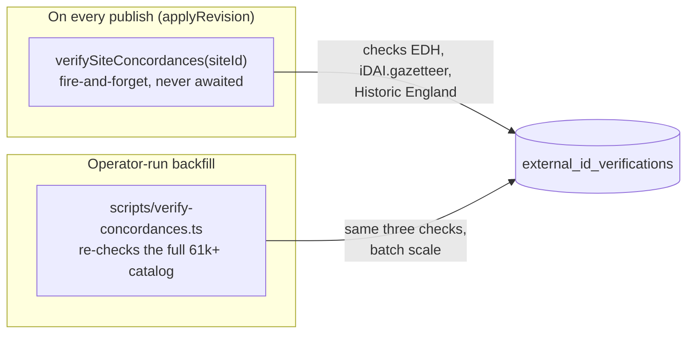

The live-write path is intentionally fire-and-forget: an external API
timing out must never delay or fail a contribution's own approval — the same
fail-open philosophy applied throughout this project (rate limiting, mail
delivery).

### 6.5 Translation, not silent substitution

Enrichment text is **never** presented as something it isn't: a
machine-translated paragraph is explicitly labelled "Machine-translated from
Dutch," the original-language version says "In Dutch," and every paragraph
carries a proper `lang` attribute. Nothing is stored — the extract is CC
BY-SA third-party content, so persisting a copy would make the app a
republisher rather than a linker; Valkey caches a hit for 7 days and a miss
for 1 day instead.

---

## 7. Accessibility (a11y)

Automated accessibility checks now run at two levels of the pipeline:

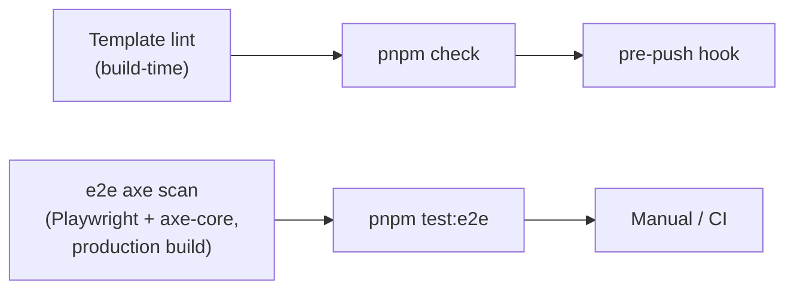

Baseline commitments (per `CLAUDE.md`'s "always" section, applied
throughout the component set):

- **Semantic HTML** — the most fitting tag is always used, never a generic
  `<div>` standing in for a button or a landmark.
- **ARIA everywhere it's needed**, and improved wherever automated scanning
  finds a gap — a template-lint step now catches obvious issues (missing
  labels, invalid roles) before code ever reaches a human reviewer, and an
  end-to-end **axe-core scan against the real production build** catches
  what static linting structurally cannot (contrast against actual rendered
  colors, focus order, live-region behaviour).
- **Every form field carries an explicit `id`**, deliberately, even where
  Vue's auto-generated ids would technically work — documented as a fix for
  an SSR/CSR hydration mismatch that silently broke label association.
- **Keyboard-first interaction and keyboard-aware i18n** — the language
  switcher and theme toggle are both reachable and operable via keyboard,
  and interactive controls avoid keyboard traps.
- **Nuxt UI v3 (built on Reka UI)** is used for every interactive control
  (forms, selects, checkboxes, toasts) rather than hand-rolled equivalents —
  Reka UI ships its own accessibility behaviour (focus trapping, ARIA
  wiring) that a bespoke control would have to reimplement and re-test from
  scratch.
- **Mobile-first responsive design** at documented breakpoints (phone
  <768px, tablet <1000px, desktop above), so touch targets and layout are
  never an afterthought on the smallest viewport.
- **Honeypot fields are positioned off-screen, never `display:none`** — a
  `display:none` honeypot is invisible to assistive technology in a way that
  can trip some screen-reader heuristics and is also trivially detectable by
  bots; off-screen positioning keeps it out of the visual and interaction
  flow without hiding it from the accessibility tree in a way that would
  cause confusion.
- **Dark mode is a genuine second palette**, not an inverted filter — warm
  charcoal, never blue-grey — which matters for readers who rely on a
  specific contrast/color profile rather than raw luminance inversion.

---

## 8. Security

### 8.1 Authentication & credential handling

| Control                   | Detail                                                                                                                                                                                                                                                                                              |
| ------------------------- | --------------------------------------------------------------------------------------------------------------------------------------------------------------------------------------------------------------------------------------------------------------------------------------------------- |
| Password hashing          | **argon2id** at OWASP-recommended parameters.                                                                                                                                                                                                                                                       |
| Timing-safe login         | Always hashes, even for a non-existent user, against a `DUMMY_HASH` — prevents user enumeration via response timing.                                                                                                                                                                                |
| Password reset            | Identical response whether or not the address exists; a token's **SHA-256 hash** only is stored, compared with `timingSafeEqual`.                                                                                                                                                                   |
| Registration              | Trades the enumeration guarantee for usability: a duplicate email/display name returns 409 (documented, deliberate trade-off — throttled by rate limiting to bound the leak).                                                                                                                       |
| Unverified login          | Re-sends the confirmation link, throttled to at most once per 15 minutes, placed **below** the credential check since there is nothing left to enumerate once the password is already confirmed correct.                                                                                            |
| Credential changes        | Both password _and_ email change require re-entering the **current password** — a session proves a past login, not present possession.                                                                                                                                                              |
| Two-factor authentication | Opt-in **TOTP (RFC 6238)** — no third-party provider at all; a shared secret and the current time, checked entirely server-side and in the user's own authenticator app. Ten single-use backup codes, hashed the same way as email tokens. Disabling 2FA requires both password _and_ a valid code. |
| Session cookie            | Sealed (iron-seal) and now correctly **expires** — an earlier unset `maxAge` meant a captured session was valid forever; there is no server-side revocation since sessions are stateless, so expiry is the only mitigation.                                                                         |

### 8.2 Signup / bot resistance

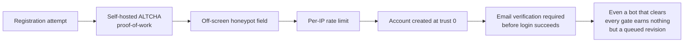

ALTCHA replaced Turnstile specifically to remove the app's last third-party
runtime dependency — a deliberate trade: it _prices_ automated signup rather
than _detecting_ it, which is weaker against a well-funded attacker, but
acceptable because a fresh account starts at trust level 0 and every
contribution it makes still goes through the moderation pipeline in §2.3.

### 8.3 Upload safety

- The declared content type is treated as a hint only; **real format is
  read from magic bytes**.
- Every image is **re-encoded through sharp**, which strips EXIF and
  guarantees the stored object is a plain JPEG — no client-crafted file
  metadata or embedded payload survives.
- **`sharp` is given an explicit `limitInputPixels`** — its default ~268 MP
  ceiling meant a small, compressible PNG under the body-size limit could
  decode to roughly a gigabyte of resident memory, especially once
  `.rotate()` forces a full decode.
- Storage keys are derived from database ids, **never** from the uploaded
  filename.
- Images with an unresolved (`UNKNOWN`) or all-rights-reserved licence are
  never published.

### 8.4 Network-facing hardening

| Control                              | Detail                                                                                                                                                                                                                                                                                                                              |
| ------------------------------------ | ----------------------------------------------------------------------------------------------------------------------------------------------------------------------------------------------------------------------------------------------------------------------------------------------------------------------------------- |
| Trusted-proxy IP resolution          | Forwarded headers are believed only behind `NUXT_BEHIND_TRUSTED_PROXY`; `x-forwarded-for` is **deliberately never read** (Bunny puts the CDN's own address first), `x-real-ip` is used instead.                                                                                                                                     |
| Rate limiting                        | Fails **open** on a cache outage (never locks everyone out) — but the outage itself is now surfaced via `rate_limit_decisions_total{outcome="failed_open"}` and an alert, and `/api/ready` factors in the same cache check so the instance drops out of the load balancer rather than reporting healthy while silently unprotected. |
| CSP                                  | Allows only the specific map-asset origins listed in `nuxt.config.ts`; the Scalar API-doc bundle's `cdn.jsdelivr.net` allowance is gated to development only.                                                                                                                                                                       |
| Detection vs. enforcement            | CrowdSec reads the app's own structured audit logs and writes decisions; **nothing is enforced yet** — a decision requires a bouncer, deliberately placed at the CDN edge rather than this box, since Hetzner's DDoS protection stops at L3/L4.                                                                                     |
| Alternatives considered and rejected | Fingerprinting (GDPR/ePrivacy exposure, redundant with ALTCHA + trust 0), fail2ban (bans CDN edge IPs, not real clients), SafeLine, Coraza, KrakenD, Wazuh, Zeek/Snort/Suricata — each with a documented, specific reason.                                                                                                          |

### 8.5 Input handling philosophy

Vestigian runs with `nuxt-security`'s generic `xssValidator` **turned off**
— a considered decision, not an oversight. That validator HTML-escapes
anything it can't parse as a recognised tag and then rejects the whole
request the moment filtering changes a byte, which meant an entirely
innocent site description like _"the wall is <2m tall"_ was refused
identically to an actual `<script>` payload. The design instead relies on
two narrower, verifiable guarantees:

1. **No `v-html` exists anywhere in the codebase** (confirmed by grep), so
   every value a Vue template renders is escaped by `{{ }}` regardless.
2. **Free-text input is stripped of markup on the way in, not merely
   escaped on the way out** — `stripHtml` runs inside the zod validation
   pipeline for every site/tracing description, so the stored payload (and
   everything derived from it, including revision history) is plain text
   even if a future surface renders it outside Vue entirely (an RSS export,
   the public GeoJSON feed, etc.).

The two non-Vue-rendered surfaces that exist today — HTML email and the GPX
export — encode explicitly for their own context (`escapeHtml`,
`escapeXml`) and are unit-tested specifically for that encoding.

### 8.6 Local static analysis (this session's own work)

The project has no hosted SonarQube instance; **`eslint-plugin-sonarjs`**
was added as a local, offline equivalent covering SonarQube's own bug- and
code-smell rule categories (nested-conditional/ternary/template-literal
complexity, ReDoS-shaped regex, hardcoded-secret heuristics, non-crypto
randomness, fixed test waits, assertion-free tests). A full pass through the
initial 40 findings produced one genuine bug fix (dead-branch logic in
licence normalization), several readability improvements, and a handful of
narrowly scoped, documented suppressions for verified false positives —
never a blanket rule disable.

---

## 9. GDPR & legal

_Not legal advice — the operator's real identity still needs to go into the
impressum/privacy pages, and counsel should review both before real users
see them. What follows is the technical posture, verified against the
running code._

### 9.1 Data map

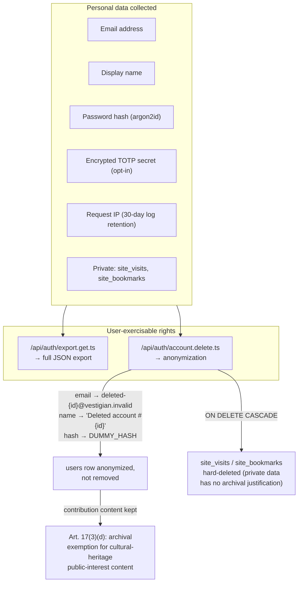

- **Right to erasure** anonymizes rather than hard-deletes a `users` row —
  `revisions.author_id`, `sites.created_by`, `tracings.created_by`, and
  `site_images.created_by` all cascade to `NULL` on hard delete, but
  anonymizing instead keeps every other contributor's history equally
  legible (no generic "unknown author" collision) while removing everything
  that identifies the erased person. The **content** of past contributions
  is retained under the Art. 17(3)(d) archival-material-of-public-interest
  exemption — a reasonable position for a cultural-heritage atlas, flagged
  explicitly as needing legal confirmation rather than treated as settled.
  The **private notebook** (`site_visits`, `site_bookmarks`) gets no such
  exemption and is hard-deleted in the same transaction — nobody else can
  read it, and keeping it serves no archival purpose.
- **Right to access/portability** is a plain authenticated export of the
  caller's own data — account fields, and every site/tracing/image/revision
  they authored. There is no admin variant.
- **A password reset notifies the real account owner** that it happened —
  the reset link itself goes to whatever inbox is on file, which may
  already be an attacker's; the follow-up notice is the one point where the
  genuine owner learns something happened at all.

### 9.2 Cookies — no consent banner, and why

Exactly three cookies exist: a 7-day session cookie, a colour-mode cookie,
and a locale cookie — all three strictly necessary for functionality the
visitor directly requested. There is **no analytics, tracking pixel, or
advertising cookie anywhere in the app** (confirmed by code search, not
assumed). Under §25(2) TDDDG (Germany's ePrivacy transposition), consent is
required for storing/reading something on a device **beyond what a
requested feature needs** — which is not the case here, so a banner would be
consent theatre. This exemption is explicitly conditional: the moment
analytics or an advertising cookie is added, that addition is what needs a
banner.

### 9.3 Third-party / cross-border data flows

| Recipient                                                    | What reaches them                                                                                                                                                                                      | Basis / mitigation                                                                                                   |
| ------------------------------------------------------------ | ------------------------------------------------------------------------------------------------------------------------------------------------------------------------------------------------------ | -------------------------------------------------------------------------------------------------------------------- |
| **Wikidata / Wikipedia / Pleiades**                          | Nothing from the visitor — the server proxies every enrichment call, so only the app server's own IP is exposed.                                                                                       |
| **Heidelberg University Library**                            | Nothing from the visitor — viewing the Column of Marcus Aurelius's plates is served by a server-side IIIF proxy, for the same reason: a direct browser request to that host fails outright regardless. |
| **CrowdSec central blocklist**                               | IP addresses already flagged as abusive, shared with the community blocklist (`DISABLE_ONLINE_API: false`)                                                                                             | Legitimate interest (abuse prevention); documented in the privacy policy's recipients section.                       |
| **Mapterhorn basemap tiles**                                 | Visitor IP, fetched **directly by the browser**, the same as any embedded map tile host                                                                                                                | Hosting jurisdiction **not yet confirmed** — flagged as needing verification before the privacy policy is finalized. |
| **DARE (Gothenburg), EOX (Vienna), OmnesViae (Netherlands)** | Visitor IP, for basemap/manuscript tile requests, until a self-hosted mirror is built and pointed at                                                                                                   | Courtesy-contact relationships established with each maintainer before any at-scale traffic; EU-hosted throughout.   |
| **Lettermint**                                               | Recipient email + display name, for transactional mail only                                                                                                                                            | EU-hosted, replaced a US provider specifically to keep this data inside the EU.                                      |

### 9.4 Licensing discipline as a legal control, not just an attribution nicety

The project treats data licence terms as a hard architectural boundary, not
a footnote:

- **ODbL (AWMC) and CC BY (Pleiades) data lives in entirely separate
  tables**, never joined to the CC BY-SA/CC0 contributed `sites` table —
  ODbL's share-alike clause attaches to a derivative _database_, and folding
  these rows together would risk pulling the contributed-data feed under
  ODbL's terms.
- **A dataset with no confirmed licence (the Tabula Peutingeriana network)
  is imported into its own tables but never served** until an operator
  explicitly enables it — the import touches nothing a visitor can see;
  serving is a separate, consciously flipped switch.
- **Every later overlay (battles, ports, routes, minor antiquities, coin
  hoards) got the same own-table, own-attribution treatment from the start**
  — and for four of them (ports CC BY, routes CC BY, minor antiquities
  ODbL, coin hoards CC BY-NC-SA) crediting the source on the map is the
  licence condition itself, not a courtesy. This was missed on first build
  — none of the seven newer overlay sources set a MapLibre `attribution` at
  all — and surfaced only once the vici-sourced site overlay went off by
  default, since that source had been carrying the map's one visible credit
  line for everything else.
- **Image licences are tracked per record** (`licence`, `attribution`
  columns are non-null), because unlike the text/metadata (CC BY-SA/CC0
  uniformly), image rights vary photograph by photograph.

### 9.5 Log retention

IP addresses are logged and retained for **30 days** in Loki, on a
legitimate-interest basis (abuse investigation) — the same field that is
_not_ redacted by the logger's `REDACTED_FIELDS` list, which does scrub
passwords, emails, and tokens. Rate-limit keys in Valkey embed a plaintext
IP for at most one hour (the longest configured rate-limit window).

---

## 10. Observability

Six containers, one agent doing three jobs:

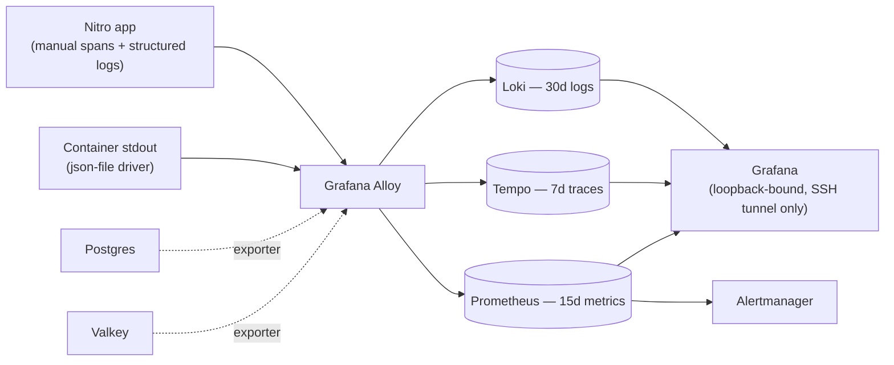

- **Everything lives on local disk** — no object-storage cost, since
  telemetry here is diagnostic rather than a record of record; under 20 GB
  total against a 240 GB disk.
- **Tracing is manual, deliberately** — no auto-instrumentation, because
  Nitro ships only its compiled `.output` with no `node_modules` for a
  loader hook to resolve against, and `postgres.js` has no OTel package
  regardless. Spans exist exactly where `withSpan()` is called.
- The whole point of this stack, stated directly in the project's own
  notes: the application **fails open in eight distinct places**, and every
  one of them used to be silent. The rate limiter failing open on a Valkey
  outage is the sharpest example — it used to remove every policy,
  including the signup throttle that is the app's actual defence against
  account farming, with nothing recording that it had happened.
- **Grafana itself has no public router** and binds to loopback only —
  reached exclusively via an SSH tunnel, since its own dashboards surface
  visitor IPs and the moderation trail.

---

## 11. Other notable engineering decisions

A few things worth knowing that don't fit neatly under the headings above,
but materially shape how trustworthy and maintainable this project is:

- **The vici.org MySQL schema was originally _inferred_, then verified
  against a real dump — and the guess was wrong in every particular.**
  There is no `places` table, no `lines` table; the real shape (`points`,
  `psummaries`/`ptexts`, `pmetadata`, `pkinds`, `plines`/`pline_data`) was
  discovered by actually reading the dump, and four specific import traps
  were found this way (swapped lat/lng in `pline_data`, `line_kind`
  meaning something entirely different from "category," each tracing
  stored six times pre-generalized, and free-text concordance identifiers
  needing an allowlist parser rather than a naive split). This is a running
  theme in the project's own documentation: **guesses are explicitly
  flagged as guesses**, and every one that has since been checked against
  real data or a real browser run is recorded as either confirmed or
  corrected, never silently assumed correct.
- **Migrations are hand-written**, not generated, because `drizzle-kit`
  cannot emit PostGIS geometry columns, GiST indexes, or the expression
  indexes behind search — a documented trap for anyone tempted to
  regenerate from the schema files.
- **A one-counter cache invalidation strategy** (`bumpDataVersion()` /
  atlas's own separate generation counter) rather than per-record cache
  keys — deliberate, because approvals are rare and tile reads are not, so
  the cost of invalidating everything at once is far lower than the
  complexity of tracking per-tile dependencies.
- **Every route's OpenAPI documentation is derived from the same zod schema
  the handler validates against** (`zodToJsonSchema`), specifically so a
  route's real validation and its published documentation can never drift
  apart — and that documentation is hard-gated to development only (two
  independent checks, not one) since a machine-readable map of every
  parameter and response shape is a convenience for developers, not
  something to leave reachable on the public internet.
- **A pre-commit hook keeps all six locales in sync automatically** — when
  the English source catalogue changes, translation runs _before_ linting,
  and a translation failure blocks the commit outright rather than letting
  a locale silently go stale.
- **Backups exist but are not yet off-box** — nightly `pg_dump` on the same
  VPS it's backing up, honestly documented under "Not built" as a real gap
  rather than glossed over, since one VPS is one failure domain until an
  off-site copy exists.
- **Third-party sources are verified live, not assumed from memory or
  documentation, before anything is built against them.** A source that
  looks reachable can sit behind a bot wall that only shows up when actually
  queried — Heidelberg University Library's IIIF API, evaluated for a
  planned feature, turned out to be openly reachable even though its
  human-facing HTML viewer pages are not, a distinction only a real request
  revealed. A licence tag can also differ from what a summary implies (a
  "no known copyright" Public Domain Mark is not the same legal act as an
  active CC0 dedication). This check-before-build discipline is now a
  standing rule in CLAUDE.md's "Also, always" list, not a one-off.

---

_Generated from the project's own documented architecture, security
invariants, and governance model (`CLAUDE.md`) as maintained in this
repository. Where the source material itself flags something as unverified
or provisional, this summary preserves that flag rather than presenting it
as settled fact._
